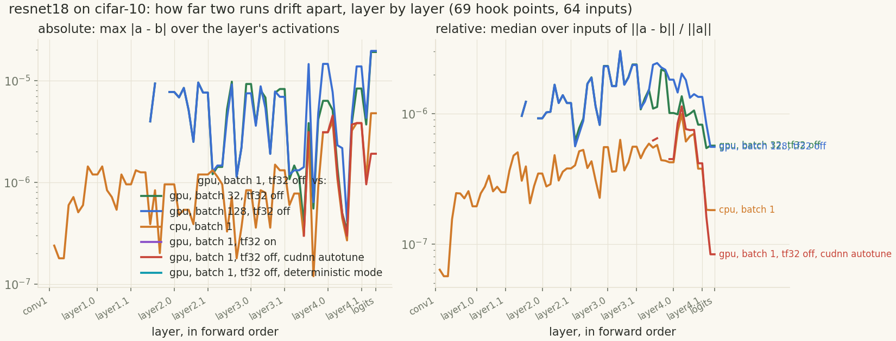

# drift

run the same neural network on the same input twice and you can get different numbers. run it on a cpu instead of a gpu, or with 32 images in a batch instead of 1, and you reliably do. this repo measures when two runs of the same model stop agreeing, how far apart they get layer by layer, and whether it ever changes the prediction. the model is resnet18 on the cifar-10 test set (all 10,000 images), with a small transformer on ag news as a second opinion. every number below comes from a run whose json sits beside it in `results/`; nothing is typed in by hand.



the short answer, on a t4: no knob changed a single prediction. not one of the 10,000 images or 7,600 texts came out with a different top-1 class under any configuration, even though several knobs changed every image's logits. the backends you would actually deploy on are a different story: fp16 is where answers start to move.

## what is measured

one trained model, one fixed reference run, and one knob changed at a time:

- batch size 1, 8, 32, 128: each image's logits computed alone against the same image inside a batch
- cpu against gpu
- tf32 on against off (`torch.backends.cuda.matmul.allow_tf32` and `torch.backends.cudnn.allow_tf32`)
- `torch.backends.cudnn.benchmark` and `torch.backends.cudnn.deterministic`
- `torch.use_deterministic_algorithms(True)` with `CUBLAS_WORKSPACE_CONFIG=:4096:8`
- cpu thread count 1, 4 and the default
- the identical configuration run again, in the same process and in a new process

for every pair: max and median absolute difference in the logits, relative difference (per image, `||a - b|| / ||a||`), how many images came out bitwise identical, how many changed their top-1 class, and where the changed ones sit in the reference run's margin distribution (the margin is the gap between the top two logits). forward hooks on every leaf module record the per-layer absolute and relative difference for a subset of inputs. wall-clock per configuration is recorded so the cost of each knob is visible.

## results

<!-- TABLE: env -->
| | |
|---|---|
| gpu | Tesla T4 |
| driver | 580.82.07 |
| cuda | 13.0 |
| cudnn | 92800 |
| cpu | Intel(R) Xeon(R) CPU @ 2.00GHz (2 logical) |
| torch | 2.14.1+cu130 |
| torchvision | 0.29.1+cu130 |
| python | 3.13.16 |
| os | Linux-6.6.159+-x86_64-with-glibc2.39 |
<!-- /TABLE -->

### resnet18 on cifar-10

<!-- TABLE: knobs_resnet -->
| knob | compared against | max abs | median abs | max rel | median rel | bitwise identical | flips | time (base, other) |
|---|---|---|---|---|---|---|---|---|
| same config again, same process | gpu, batch 1, tf32 off | 0 | 0 | 0 | 0 | 10,000 / 10,000 | 0 | 29.0 s, 28.3 s |
| same config again, new process | gpu, batch 1, tf32 off | 0 | 0 | 0 | 0 | 10,000 / 10,000 | 0 | 29.0 s, 28.3 s |
| batch size 8 | gpu, batch 1, tf32 off | 8.11e-06 | 3.58e-07 | 1.49e-06 | 1.58e-07 | 0 / 10,000 | 0 | 29.0 s, 4.8 s |
| batch size 32 | gpu, batch 1, tf32 off | 3.86e-05 | 1.19e-06 | 4.67e-06 | 5.30e-07 | 0 / 10,000 | 0 | 29.0 s, 2.8 s |
| batch size 128 | gpu, batch 1, tf32 off | 2.91e-05 | 1.31e-06 | 5.05e-06 | 5.44e-07 | 0 / 10,000 | 0 | 29.0 s, 2.9 s |
| cpu instead of gpu | gpu, batch 1, tf32 off | 8.11e-06 | 4.17e-07 | 1.43e-06 | 1.78e-07 | 0 / 10,000 | 0 | 29.0 s, 214.6 s |
| tf32 on | gpu, batch 1, tf32 off | 0 | 0 | 0 | 0 | 10,000 / 10,000 | 0 | 29.0 s, 28.5 s |
| cudnn benchmark | gpu, batch 1, tf32 off | 3.81e-06 | 1.79e-07 | 3.09e-07 | 8.50e-08 | 0 / 10,000 | 0 | 29.0 s, 26.4 s |
| cudnn deterministic | gpu, batch 1, tf32 off | 0 | 0 | 0 | 0 | 10,000 / 10,000 | 0 | 29.0 s, 28.6 s |
| deterministic algorithms | gpu, batch 1, tf32 off | 0 | 0 | 0 | 0 | 10,000 / 10,000 | 0 | 29.0 s, 30.5 s |
| tf32 on, batch 128 | gpu, batch 128, tf32 off | 0 | 0 | 0 | 0 | 10,000 / 10,000 | 0 | 2.9 s, 2.8 s |
| cudnn benchmark, batch 128 | gpu, batch 128, tf32 off | 3.77e-05 | 1.67e-06 | 5.39e-06 | 6.83e-07 | 0 / 10,000 | 0 | 2.9 s, 2.3 s |
| cudnn deterministic, batch 128 | gpu, batch 128, tf32 off | 0 | 0 | 0 | 0 | 10,000 / 10,000 | 0 | 2.9 s, 2.8 s |
| deterministic algorithms, batch 128 | gpu, batch 128, tf32 off | 0 | 0 | 0 | 0 | 10,000 / 10,000 | 0 | 2.9 s, 2.9 s |
| batch 128 again, same process | gpu, batch 128, tf32 off | 0 | 0 | 0 | 0 | 10,000 / 10,000 | 0 | 2.9 s, 2.8 s |
| batch 128 again, new process | gpu, batch 128, tf32 off | 0 | 0 | 0 | 0 | 10,000 / 10,000 | 0 | 2.9 s, 2.9 s |
<!-- /TABLE -->

flips by margin bucket:

<!-- TABLE: margin_resnet -->
no pair flipped a prediction.
<!-- /TABLE -->

divergence through depth:

<!-- TABLE: depth_resnet -->
| pair | layers | first layer rel | last layer rel | ratio | first layer abs max | last layer abs max | ratio |
|---|---|---|---|---|---|---|---|
| gpu, batch 1, tf32 off vs gpu, batch 32, tf32 off | 69 | 9.61e-07 | 5.68e-07 | 0.6x | 3.96e-06 | 1.91e-05 | 4.8x |
| gpu, batch 1, tf32 off vs gpu, batch 128, tf32 off | 69 | 9.61e-07 | 5.56e-07 | 0.6x | 3.96e-06 | 1.96e-05 | 4.9x |
| gpu, batch 1, tf32 off vs cpu, batch 1 | 69 | 6.35e-08 | 1.82e-07 | 2.9x | 2.38e-07 | 4.77e-06 | 20.0x |
| gpu, batch 1, tf32 off vs gpu, batch 1, tf32 on | 69 | bitwise identical at every layer | | | | | |
| gpu, batch 1, tf32 off vs gpu, batch 1, tf32 off, cudnn autotune | 69 | 6.23e-07 | 8.33e-08 | 0.1x | 2.98e-07 | 1.91e-06 | 6.4x |
| gpu, batch 1, tf32 off vs gpu, batch 1, tf32 off, deterministic mode | 69 | bitwise identical at every layer | | | | | |
<!-- /TABLE -->

### small transformer on ag news

<!-- TABLE: knobs_text -->
| knob | compared against | max abs | median abs | max rel | median rel | bitwise identical | flips | time (base, other) |
|---|---|---|---|---|---|---|---|---|
| same config again, same process | gpu, batch 1, tf32 off | 0 | 0 | 0 | 0 | 7,600 / 7,600 | 0 | 12.5 s, 12.9 s |
| same config again, new process | gpu, batch 1, tf32 off | 0 | 0 | 0 | 0 | 7,600 / 7,600 | 0 | 12.5 s, 13.2 s |
| batch size 8 | gpu, batch 1, tf32 off | 1.91e-06 | 1.19e-07 | 1.36e-06 | 6.94e-08 | 261 / 7,600 | 0 | 12.5 s, 1.7 s |
| batch size 32 | gpu, batch 1, tf32 off | 1.91e-06 | 2.38e-07 | 1.47e-06 | 8.84e-08 | 45 / 7,600 | 0 | 12.5 s, 0.5 s |
| batch size 128 | gpu, batch 1, tf32 off | 1.91e-06 | 2.38e-07 | 1.47e-06 | 8.84e-08 | 45 / 7,600 | 0 | 12.5 s, 0.3 s |
| cpu instead of gpu | gpu, batch 1, tf32 off | 2.86e-06 | 2.38e-07 | 2.15e-06 | 1.00e-07 | 36 / 7,600 | 0 | 12.5 s, 15.0 s |
| tf32 on | gpu, batch 1, tf32 off | 0 | 0 | 0 | 0 | 7,600 / 7,600 | 0 | 12.5 s, 12.7 s |
| cudnn benchmark | gpu, batch 1, tf32 off | 0 | 0 | 0 | 0 | 7,600 / 7,600 | 0 | 12.5 s, 13.2 s |
| cudnn deterministic | gpu, batch 1, tf32 off | 0 | 0 | 0 | 0 | 7,600 / 7,600 | 0 | 12.5 s, 12.4 s |
| deterministic algorithms | gpu, batch 1, tf32 off | 0 | 0 | 0 | 0 | 7,600 / 7,600 | 0 | 12.5 s, 14.5 s |
| tf32 on, batch 128 | gpu, batch 128, tf32 off | 0 | 0 | 0 | 0 | 7,600 / 7,600 | 0 | 0.3 s, 0.3 s |
| cudnn benchmark, batch 128 | gpu, batch 128, tf32 off | 0 | 0 | 0 | 0 | 7,600 / 7,600 | 0 | 0.3 s, 0.3 s |
| cudnn deterministic, batch 128 | gpu, batch 128, tf32 off | 0 | 0 | 0 | 0 | 7,600 / 7,600 | 0 | 0.3 s, 0.3 s |
| deterministic algorithms, batch 128 | gpu, batch 128, tf32 off | 0 | 0 | 0 | 0 | 7,600 / 7,600 | 0 | 0.3 s, 0.3 s |
| batch 128 again, same process | gpu, batch 128, tf32 off | 0 | 0 | 0 | 0 | 7,600 / 7,600 | 0 | 0.3 s, 0.2 s |
| batch 128 again, new process | gpu, batch 128, tf32 off | 0 | 0 | 0 | 0 | 7,600 / 7,600 | 0 | 0.3 s, 0.3 s |
<!-- /TABLE -->

<!-- TABLE: depth_text -->
| pair | layers | first layer rel | last layer rel | ratio | first layer abs max | last layer abs max | ratio |
|---|---|---|---|---|---|---|---|
| gpu, batch 1, tf32 off vs gpu, batch 32, tf32 off | 22 | 2.24e-07 | 8.86e-08 | 0.4x | 2.15e-06 | 1.43e-06 | 0.7x |
| gpu, batch 1, tf32 off vs gpu, batch 128, tf32 off | 22 | 2.24e-07 | 8.86e-08 | 0.4x | 2.15e-06 | 1.43e-06 | 0.7x |
| gpu, batch 1, tf32 off vs cpu, batch 1 | 22 | 7.42e-08 | 1.03e-07 | 1.4x | 9.54e-07 | 1.55e-06 | 1.6x |
| gpu, batch 1, tf32 off vs gpu, batch 1, tf32 on | 22 | bitwise identical at every layer | | | | | |
| gpu, batch 1, tf32 off vs gpu, batch 1, tf32 off, cudnn autotune | 22 | bitwise identical at every layer | | | | | |
| gpu, batch 1, tf32 off vs gpu, batch 1, tf32 off, deterministic mode | 22 | bitwise identical at every layer | | | | | |
<!-- /TABLE -->

## what the numbers say

batch size moved the logits more than anything else: a different batch size runs different kernels, so every image's logits shift, by a few parts in a million relative to their size. `cudnn.benchmark` matches it at batch 128 and does much less at batch 1, and cpu against gpu sits in between. the tf32 flags do nothing on a t4, which has no tf32 units. `cudnn.deterministic` and `use_deterministic_algorithms` came out bitwise identical to the defaults and cost a few percent of wall-clock at most. the same configuration run twice, in one process or two, was bitwise identical every time.

none of it reaches the decision. the largest disagreement any knob produced is orders of magnitude smaller than the smallest gap between the top two logits in the test set, so there is nothing for it to flip. through the network's depth, absolute error grows every time as activations get larger, but relative error does not: it shrinks from the first layer to the last for batch size and the autotuner, and only cpu against gpu makes it grow.

## inference backends

a second stage (`serve_stage2.py`) runs the same trained resnet18 through the backends you would actually deploy on: eager pytorch, `torch.compile` and tensorrt, at fp32 and fp16, at batch 1, 8, 32 and 128. each one is diffed against eager fp32 at the same batch size, so the comparison isolates the backend rather than the batch. eager and compiled fp16 use autocast, which keeps some ops in fp32; the tensorrt fp16 engine is built from a half-precision graph, so everything inside it runs in fp16.

<!-- TABLE: serve_headline -->
at batch 1 the fastest backend was trt_fp16, 0.528 ms p50 against eager fp32's 2.651 ms (5.0x). at batch 128 the fastest was trt_fp16 at 20,771 img/s and the slowest eager_fp32 at 3,593 img/s. the most predictions any backend changed was 6 of 10,000 (trt_fp16 at batch 8). the largest fp32 disagreement reached 0.00401 of the margin it would need to cross, and fp32 flipped 0 predictions in total.
<!-- /TABLE -->

<!-- TABLE: serve_speed -->
| backend | batch | p50 ms | p99 ms | img/s | build s | peak mb | accuracy |
|---|---:|---:|---:|---:|---:|---:|---:|
| eager_fp32 | 1 | 2.651 | 3.807 | 377 | 0.0 | 184 | 94.98% |
| eager_fp32 | 8 | 4.062 | 6.943 | 1,970 | 0.0 | 188 | 94.98% |
| eager_fp32 | 32 | 8.697 | 8.913 | 3,680 | 0.0 | 219 | 94.98% |
| eager_fp32 | 128 | 35.629 | 36.381 | 3,593 | 0.0 | 475 | 94.98% |
| eager_fp16 | 1 | 3.491 | 5.076 | 286 | 0.0 | 207 | 94.99% |
| eager_fp16 | 8 | 3.449 | 4.827 | 2,320 | 0.0 | 208 | 94.99% |
| eager_fp16 | 32 | 4.424 | 5.754 | 7,233 | 0.0 | 212 | 95.00% |
| eager_fp16 | 128 | 14.607 | 14.840 | 8,763 | 0.0 | 278 | 95.00% |
| compile_fp32 | 1 | 2.453 | 2.629 | 408 | 9.6 | 229 | 94.98% |
| compile_fp32 | 8 | 3.720 | 5.434 | 2,150 | 1.4 | 226 | 94.98% |
| compile_fp32 | 32 | 7.999 | 8.522 | 4,000 | 0.0 | 338 | 94.98% |
| compile_fp32 | 128 | 32.552 | 33.167 | 3,932 | 0.0 | 861 | 94.98% |
| compile_fp16 | 1 | 1.477 | 2.837 | 677 | 3.3 | 204 | 95.00% |
| compile_fp16 | 8 | 2.394 | 2.895 | 3,341 | 1.1 | 226 | 94.98% |
| compile_fp16 | 32 | 4.077 | 4.674 | 7,850 | 0.0 | 283 | 94.98% |
| compile_fp16 | 128 | 13.027 | 13.664 | 9,826 | 0.0 | 523 | 94.98% |
| trt_fp32 | 1 | 1.171 | 1.380 | 854 | 9.8 | 177 | 94.98% |
| trt_fp32 | 8 | 2.527 | 3.285 | 3,166 | 8.1 | 177 | 94.98% |
| trt_fp32 | 32 | 7.737 | 7.988 | 4,136 | 8.5 | 177 | 94.98% |
| trt_fp32 | 128 | 30.644 | 31.328 | 4,177 | 14.0 | 177 | 94.98% |
| trt_fp16 | 1 | 0.528 | 0.730 | 1,894 | 16.7 | 223 | 94.98% |
| trt_fp16 | 8 | 0.744 | 0.848 | 10,752 | 15.0 | 248 | 94.98% |
| trt_fp16 | 32 | 2.029 | 2.924 | 15,775 | 15.6 | 271 | 94.98% |
| trt_fp16 | 128 | 6.162 | 6.600 | 20,771 | 18.3 | 272 | 94.97% |
<!-- /TABLE -->

numerics against eager fp32 at the same batch size. headroom is the largest disagreement as a fraction of that image's own top-two margin: below 1, no prediction can change.

<!-- TABLE: serve_numerics -->
| backend | batch | max abs | max rel | bitwise identical | flips | headroom | accuracy change |
|---|---:|---:|---:|---:|---:|---:|---:|
| eager_fp16 | 1 | 0.0322 | 0.00378 | 0 / 10,000 | 1 | 2.04 | +0.01 pts |
| eager_fp16 | 8 | 0.0322 | 0.00404 | 0 / 10,000 | 1 | 1.72 | +0.01 pts |
| eager_fp16 | 32 | 0.0361 | 0.00392 | 0 / 10,000 | 2 | 2.03 | +0.02 pts |
| eager_fp16 | 128 | 0.0362 | 0.00394 | 0 / 10,000 | 2 | 2.8 | +0.02 pts |
| compile_fp32 | 1 | 9.54e-06 | 1.17e-06 | 0 / 10,000 | 0 | 0.00132 | +0.00 pts |
| compile_fp32 | 8 | 4.77e-06 | 7.09e-07 | 0 / 10,000 | 0 | 6.34e-04 | +0.00 pts |
| compile_fp32 | 32 | 3.34e-05 | 5.20e-06 | 0 / 10,000 | 0 | 0.00358 | +0.00 pts |
| compile_fp32 | 128 | 3.24e-05 | 5.13e-06 | 0 / 10,000 | 0 | 0.00246 | +0.00 pts |
| compile_fp16 | 1 | 0.0322 | 0.00376 | 0 / 10,000 | 2 | 2.45 | +0.02 pts |
| compile_fp16 | 8 | 0.0322 | 0.00409 | 0 / 10,000 | 0 | 2.8 | +0.00 pts |
| compile_fp16 | 32 | 0.0361 | 0.00386 | 0 / 10,000 | 0 | 2.79 | +0.00 pts |
| compile_fp16 | 128 | 0.0362 | 0.00386 | 0 / 10,000 | 0 | 2.8 | +0.00 pts |
| trt_fp32 | 1 | 1.19e-05 | 1.72e-06 | 0 / 10,000 | 0 | 0.00167 | +0.00 pts |
| trt_fp32 | 8 | 9.06e-06 | 1.49e-06 | 0 / 10,000 | 0 | 0.00125 | +0.00 pts |
| trt_fp32 | 32 | 3.67e-05 | 5.09e-06 | 0 / 10,000 | 0 | 0.00401 | +0.00 pts |
| trt_fp32 | 128 | 3.00e-05 | 5.09e-06 | 0 / 10,000 | 0 | 0.00333 | +0.00 pts |
| trt_fp16 | 1 | 0.0586 | 0.00711 | 0 / 10,000 | 4 | 17.8 | +0.00 pts |
| trt_fp16 | 8 | 0.0617 | 0.00789 | 0 / 10,000 | 6 | 11.3 | +0.00 pts |
| trt_fp16 | 32 | 0.0644 | 0.00692 | 0 / 10,000 | 5 | 18 | +0.00 pts |
| trt_fp16 | 128 | 0.0569 | 0.00828 | 0 / 10,000 | 2 | 10.3 | -0.01 pts |
<!-- /TABLE -->

the tolerance you would need to diff each backend against eager fp32 in a test without tripping on precision noise:

<!-- TABLE: serve_tolerance -->
| backend | atol | rtol |
|---|---:|---:|
| eager_fp16 | 0.0362 | 0.00404 |
| compile_fp32 | 3.34e-05 | 5.20e-06 |
| compile_fp16 | 0.0362 | 0.00409 |
| trt_fp32 | 3.67e-05 | 5.09e-06 |
| trt_fp16 | 0.0644 | 0.00828 |
<!-- /TABLE -->

<!-- TABLE: serve_notes -->
- no tf32 units on this device, so there is no tf32 row to measure
- no bf16 tensor core path on this device, so fp16 is the only reduced precision worth timing; a bf16 row would measure emulation
- eager fp32 at batch 1 reproduced stage 1's reference logits bitwise on 10,000 of 10,000 images
<!-- /TABLE -->

the precision ladder is the finding. every fp32 path, compiled or through tensorrt, stays far under the margin and changes nothing. autocast fp16 crosses the margin and moves a prediction or two. full fp16 inside tensorrt nearly doubles that disagreement again and moves a few more. every prediction that moved was a near-tie, so accuracy barely changes: a flip is a stability fact, not an accuracy fact. full fp16 tensorrt is also the fastest thing measured at every batch size, so the speed and the instability come from the same place.

## what to actually do about it

- do not chase bitwise reproducibility across batch sizes, devices or cudnn's autotuner. the forward pass of a trained network is not the same computation at batch 1 and batch 32, and no flag makes it so. compare models and predictions with a tolerance, and pick the tolerance from a measurement like this one rather than from a feeling.
- if you need the same bits from the same configuration twice, you already have it: the default kernels at a fixed shape were bitwise repeatable here, in the same process and across processes. `torch.use_deterministic_algorithms(True)` buys you nothing in that setting and costs a little; it earns its keep for ops with atomics (scatter, index_add, some backward kernels), which an inference-only resnet does not touch.
- if you do turn determinism on, measure what it costs on your shapes. here it was a few percent of wall-clock, not the 2x people warn about, because resnet18's convolutions already run deterministic cudnn kernels.
- set `torch.backends.cudnn.benchmark` to the same value in every run you intend to compare, and keep the comparison on one device. after batch size, those two knobs moved the logits most.
- tf32 is a non-event on turing (t4) because the hardware has no tf32 units. on ampere and later it is on by default for cudnn convolutions, so a run on a t4 and a run on an a100 differ for a reason that has nothing to do with the code. turn it off explicitly (`torch.backends.cudnn.allow_tf32 = False`) if cross-machine agreement matters.
- the quantity to watch is the margin between the top two logits, not the logit error. a flip needs the disagreement to cross the margin. report the smallest margin in your evaluation set next to the largest disagreement your setup produces; if there is an order of magnitude between them, flips are not your problem.
- what would make flips appear is a low-margin regime: a weaker model, a harder dataset, lower precision (fp16, bf16, int8) or a decision threshold placed near the bulk of the score distribution. that is where the measurement should be repeated before trusting a deployment.

## reproducing it

```
pip install -r requirements.txt
bash run.sh <label>          # results/<label>/: json, charts, summary.md
```

`drift_gpu.ipynb` does the same on a colab gpu. without a gpu the sweep runs the cpu knobs only. the weights are committed in `weights/` with the training log beside them (`python -m drift.train resnet` and `python -m drift.train text` retrain them with the same seeds).

## where it falls short

- one model family for the headline (resnet18), one dataset (cifar-10), one gpu (a colab t4, turing). the transformer is small and trained for three epochs on a laptop; it is a second opinion, not a second study.
- the t4 cannot test tf32 at all. the row is there so the code path is exercised; the number says nothing about ampere.
- no training, no distributed, no quantisation, and reduced precision only as fp16 in the backends stage. int8 is the obvious next run: turing has int8 tensor cores, and it should flip far more than fp16 does.
- margins here are wide because the model is good. a 70% model on a harder set would put more images near zero margin, and the flip rate would stop being zero. the method applies; the headline does not transfer.
- the per-layer curves use 64 inputs, chosen with a fixed seed, not the whole test set.
- the cpu runs use whatever cores the colab vm has (two), so the thread-count knob is 1 against 2, and the laptop this was built on was too throttled to add a 4-thread row in time.
- the resnet weights were fetched, not trained here (`weights/resnet18_cifar10.json` has the source and checksum). the normalisation constants in `drift/data.py` are the ones that checkpoint expects, which are not the cifar-10 values most tutorials use.
